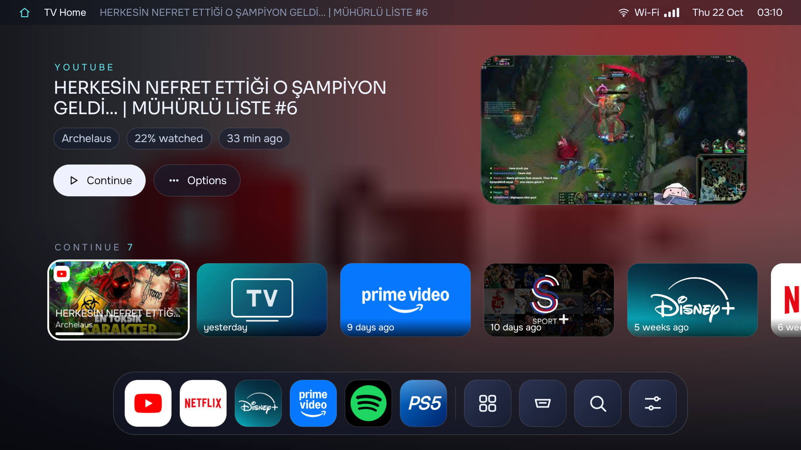
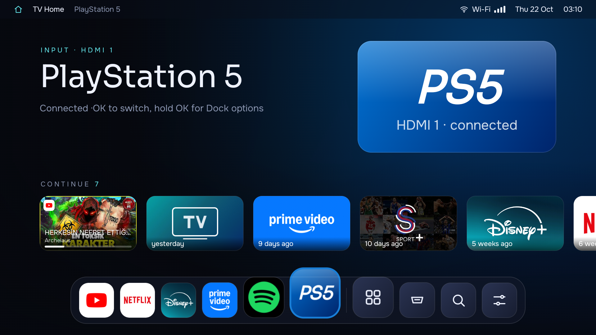
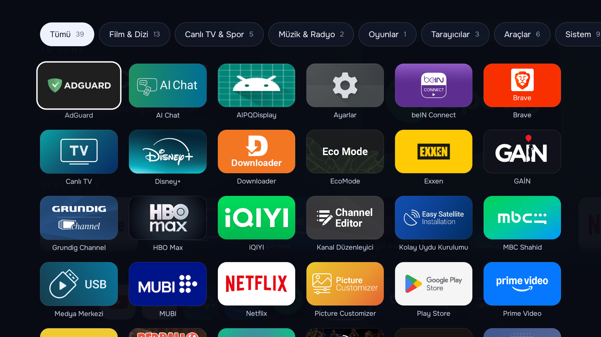
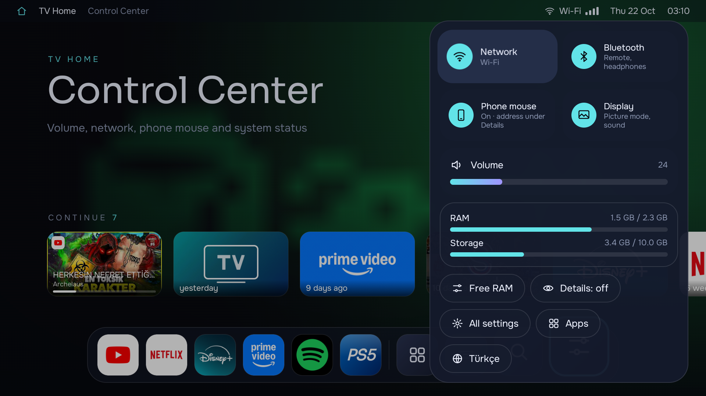
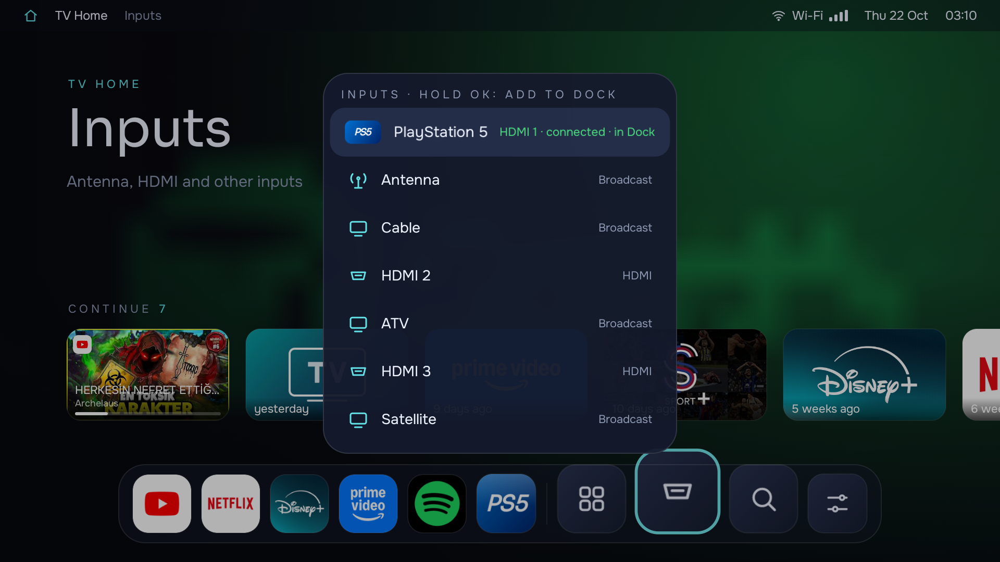
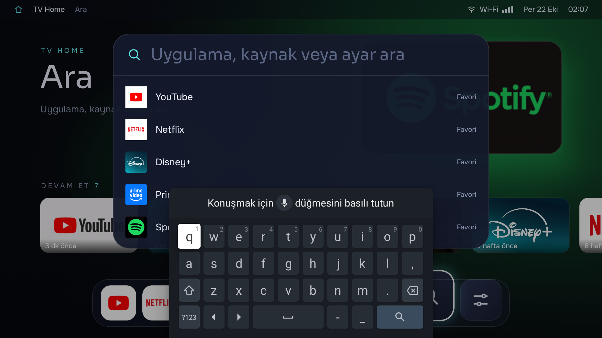
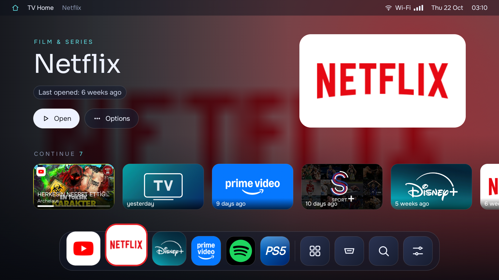

# TV Home

**A fast, ad-free, macOS-style home screen for Google TV, plus a one-command toolkit that debloats, speeds up and remote-controls the TV.**

Built for and tested on a 2024 **Grundig Nano QLED (Google TV, Android 14, MediaTek MT5896, 2.4 GB RAM)**. It should run on any Android TV / Google TV 9+.



---

## What you get

| | |
|---|---|
| **A Dock that magnifies like macOS** | Your favourite apps and inputs at the bottom, springing up as focus moves. Long-press OK on anything to add it, remove it or reorder it. |
| **Real "continue watching"** | The last YouTube video, Netflix episode, Prime film or Spotify song, with its own title, channel, progress and artwork. For YouTube, the big preview cycles through frames from inside the video. One press resumes it. |
| **Automatic categories** | Launchpad sorts every app into Film & Series, Live TV & Sport, Music, Games, Browsers, Tools… A new kind of app gets its own category the moment it is installed. |
| **Inputs by name** | HDMI-CEC devices show up by name with their brand badge (PlayStation, Xbox, Switch, Apple TV, Fire TV, Chromecast, Shield, Roku). Pin the PS5 to the Dock and switch to it in one press. |
| **Spotlight search** | Type or speak; `spor` finds every sports app, `hdmi` every input, and settings come up too. |
| **Control Center** | Network, Bluetooth, volume slider, live RAM and storage, **Free RAM** button, a switch between a clean *simple* view and a *detailed*, Windows-style view, and **English / Türkçe**. |
| **Your phone as mouse + keyboard** | Open `http://<tv-ip>:8765` on any phone (iPhone or Android, no app): touchpad, scroll, D-pad, media keys, and live typing into any text field on the TV. PIN-protected. Works from anywhere over Tailscale. |
| **Backdrop from the app itself** | Colours are extracted from each app's artwork, so the whole screen takes on YouTube red, PlayStation blue, Spotify green… |

<table>
<tr>
<td></td>
<td></td>
</tr>
<tr>
<td align="center">PS5 pinned to the Dock, brand backdrop</td>
<td align="center">Launchpad, filtered by focusing a category</td>
</tr>
<tr>
<td></td>
<td></td>
</tr>
<tr>
<td align="center">Control Center: volume, RAM, Free RAM, simple/detailed</td>
<td align="center">Inputs: the PlayStation 5 is recognised over HDMI-CEC</td>
</tr>
<tr>
<td></td>
<td></td>
</tr>
<tr>
<td align="center">Spotlight: category words find apps</td>
<td align="center">Home: app info, recents and the Dock</td>
</tr>
</table>

## The toolkit: one command per job

`tv.cmd` (Windows) and `scripts/tv.sh` (macOS / Linux) talk to the TV over ADB. Every change they make is reversible.

| Command | What it does |
|---|---|
| `tv connect <ip>` | Pair with the TV once (accept the prompt on screen) |
| `tv all` | Back up, debloat, tune and install TV Home in one go |
| `tv debloat [-Optional]` | Disable (never uninstall) ambient mode, promoted-app installer, HbbTV service, telemetry, store demo… `-Optional` adds Assistant, TTS, YouTube Music |
| `tv restore` | Re-enable everything that was disabled |
| `tv perf` · `tv optimize` | 0.5× animations, cache trim · ahead-of-time compile of all apps |
| `tv ram` · `tv ram-reset` | Kill cached apps and cap background apps at 12 (persistent) · undo |
| `tv install` | Install the launcher, enable its services, grant usage + media-session access, AOT-compile it |
| `tv takeover` · `tv untakeover` | Replace the stock Google TV home completely (Home button, boot) · bring it back |
| `tv sideload brave` | Install apps the TV's Play Store hides, from their **official** GitHub releases, picking the right CPU build. Also takes any APK URL or file |
| `tv apps tailscale airscreen tvbro` | Open Play Store pages on the TV for remote access, AirPlay mirroring, a TV browser… |
| `tv browser <package>` | Set the default browser for links |
| `tv mirror [-Remote]` | Show and control the TV from your PC/Mac (scrcpy), low-bitrate mode for use over Tailscale |
| `tv phone` · `tv lock` | Print the phone-touchpad address · turn network ADB off when done |

On Windows PowerShell, prefix commands with `.\` (for example `.\tv connect 192.168.1.50`).

## Results on the test TV

Measured on the Grundig (MT5896, 2.4 GB) with the scripts in this repo:

| | Before | After |
|---|---|---|
| Free RAM | 676 MB | **~965 MB** (debloat + `tv ram`; Google Assistant kept) |
| Home-screen frame time while navigating (median) | 101 ms | **44 ms** (no live blur or glow shadows, cached backdrop layers, AOT compile) |
| Janky frames while navigating | 100 % | **25 %** |
| Launcher memory (PSS) | — | **~49 MB** |

A simulated panel of 10 users aged 16–55 (via a persona-panel tool, not real people) reviewed the screenshots: 10 / 10 would switch once trust and install concerns were set aside. Their top wish, Netflix/Disney+ episode cards, is what the media-session history now provides.

## Quick start

1. **Enable developer mode on the TV:** *Settings → System → About → Android TV OS build*, press OK 7 times. Then *Developer options → USB debugging: On*.
2. **Note the TV's IP:** *Settings → Network & Internet*.
3. **Clone this repo** on a PC or Mac on the same network, then:
   ```powershell
   .\tv connect 192.168.1.50     # accept "Always allow" on the TV
   .\tv all                      # debloat + tune + install TV Home
   .\tv takeover                 # optional: Home and boot go straight to TV Home
   ```
   macOS: `brew install android-platform-tools`, then `cd scripts && ./tv.sh connect 192.168.1.50` and so on.
4. **Phone as mouse:** open the address shown in *Control Center → Details*, enter the PIN.

A full step-by-step guide in Turkish (remote access with Tailscale, mirroring from iPhone/Mac/Windows, browsers, settings) is in [docs/KURULUM.md](docs/KURULUM.md).

A prebuilt APK is on the [Releases](../../releases) page. It is signed with a debug key, which is fine for sideloading but not for the Play Store.

## How it works

```
launcher/app/src/main/java/app/swiip/tvhome/
├── MainActivity.kt          Home activity; loads apps, inputs, stats, history
├── AppRepository.kt         Apps + banners/icons, Palette colours, 32x18 backdrop thumbnails
├── Categories.kt            Category from browser capability → keywords → declared category
├── TvSources.kt             TV inputs; HDMI-CEC devices (e.g. PS5) replace their bare port
├── WatchHistory.kt          MediaListener records media sessions → "continue watching"
├── WatchNext.kt             System Watch Next list (empty on this TV, used when apps publish to it)
├── SystemInfo.kt            RAM / storage / network, Free RAM, volume, usage stats
├── HomeWatcherService.kt    Brings TV Home forward if the stock launcher appears
├── remote/                  Phone touchpad: NanoHTTPD + WebSocket, cursor overlay, gestures, typing
└── ui/                      DockHome (Dock, hero, rows), Overlays (Launchpad, Sources,
                             Control Center, Spotlight), Menus, Cards, DeviceBadge, Theme
```

Things learned the hard way on a low-end TV SoC:

- **Google TV has no setting to change the home app.** TV Home declares `HOME`, an accessibility service redirects the stock launcher, and `tv takeover` disables the stock launcher and takes the `android.app.role.HOME` role, since some vendor apps (Digiturk on this TV) also claim `HOME`.
- **YouTube, Netflix and co. no longer publish "continue watching" to the shared Watch Next list** on this TV. Every player still exposes a media session, so a notification-listener service reads those. YouTube video ids are resolved once from the title to fetch the cover and in-video frames from `i.ytimg.com`.
- **GPU fill-rate is the bottleneck.** `Modifier.blur`, tv-material focus glows and coloured elevation shadows each cost whole frames. Backdrops are painted once into an offscreen layer and only cross-faded.
- **The userland is 32-bit (`armeabi-v7a`)** despite a 64-bit SoC, so sideloaded APKs must be 32-bit builds.
- **HDMI-CEC devices are child TV inputs** of their port, and empty ports report "standby", so only named children count as connected.
- **A menu opened by holding OK** receives that press's release and clicks its first item, unless the window ignores OK until a fresh press starts.

## Build from source

Requires JDK 17 and the Android SDK (compileSdk 36).

```bash
cd launcher
./gradlew assembleRelease          # → app/build/outputs/apk/release/app-release.apk
cp app/build/outputs/apk/release/app-release.apk ../dist/TvHome.apk
cd ..                              # then: .\tv install (Windows) or scripts/tv.sh install (macOS/Linux)
```

Stack: Kotlin 2.2, Jetpack Compose + Compose for TV (`tv-material`), AGP 8.13, R8. Release builds are shrunk and signed with the debug keystore for sideloading.

## Notes

- The interface is **English and Turkish**: it follows the TV's language, and *Control Center → English / Türkçe* switches TV Home alone (Android 13+). The phone touchpad follows the phone's language. Script messages are still Turkish.
- Disabling packages and replacing the launcher are done with standard ADB commands and are fully reversible (`tv restore`, `tv untakeover`). Turn network ADB off when you are done (`tv lock`).
- Not affiliated with Google, Grundig, Arçelik, Sony or any app shown. See [THIRD_PARTY.md](THIRD_PARTY.md) for fonts and libraries.

## License

[MIT](LICENSE)
